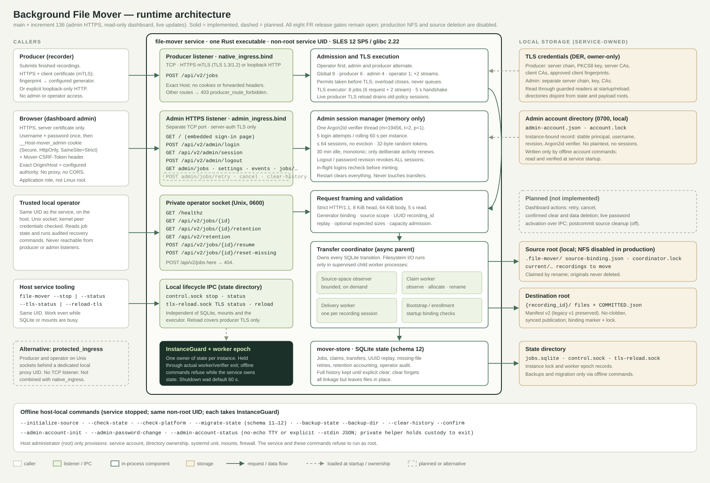

# Rust architecture

Snapshot as of 2026-11-12 (main plus [increment135](RUST-INCREMENT-135.md)).
Update the SVG when listeners, routes, storage or ownership change. Solid shapes
are implemented; dashed shapes are planned or alternative. This diagram describes
the design; it does not claim release readiness. All eight FR release gates remain open.

## Three network audiences, never mixed

| Audience | Transport | Authenticates with | Routes |
|---|---|---|---|
| Producer | `native_ingress.bind`: HTTPS mTLS, or explicit loopback HTTP | Client certificate fingerprint mapped to the configured generator | `POST /api/v2/jobs` only |
| Dashboard admin | `admin_ingress.bind`: separate HTTPS port, server certificate only | Account password, then session cookie + CSRF header | `GET /`, `POST /api/v2/admin/login`, `GET /api/v2/admin/session`, `POST /api/v2/admin/logout`, `GET /api/v2/admin/jobs`, `GET /api/v2/jobs/{id}`, `GET /api/v2/retention`, `GET /api/v2/jobs/{id}/retention`, `GET /api/v2/admin/settings` |
| Trusted local operator | Private Unix socket | Kernel peer UID equals the service UID | `GET /healthz`, job and retention reads, `resume`, `reset-missing` |

Each listener refuses the others' routes. Lifecycle (`control.sock`) and TLS
reload (`tls-reload.sock`) are separate local IPC sockets in the state directory.
With `protected_ingress`, producer and operator use Unix sockets behind a local
proxy UID instead, and there is no TCP listener.

## Request path

1. The accept loop takes a connection (operator first; admin and producer then
   alternate so neither can starve the other) and a permit from the global budget of 8 (producer 6, admin 4, one slot always
   kept for the private operator). TLS runs on a
   fixed executor pool with a 5-second handshake deadline.
2. Strict HTTP/1.1 framing and validation: generator binding, source scope, UUID
   `recording_id` replay and optional expected sizes.
3. The async coordinator records every transition in SQLite (schema 12). All
   filesystem I/O runs in supervised child workers: source-space observer, claim
   worker, delivery worker per recording, bootstrap and enrollment.
4. Recordings are claimed from the source root by rename and published to
   `{recording_id}/` in the destination with a `COMMITTED.json` v2 manifest.
   Originals are never deleted; production NFS is disabled.

## Ownership

`InstanceGuard` and the worker epoch give each state database exactly one owner.
They are held until every worker and the password verifier have actually exited.
Offline commands (bottom of the diagram) take the same guard, so they refuse
while the service runs. The host administrator only provisions the service
account, directories, unit, mounts and firewall; the service refuses root.

## Admin sessions

Sessions live only in memory: at most 64, a single Argon2id verifier thread, five
login attempts per rolling minute, a 30-minute monotonic idle timeout, and global
revocation on logout or password change. Restart clears them. Sessions never affect
transfers. See [admin HTTPS setup](ADMIN-HTTPS-SETUP.md) and the
[session design](dashboard/ADMIN-SESSION-DESIGN.md).

## Further sources

The application is implemented in Rust. Use these current sources:

- [Design direction and crate/process boundaries](RUST-DIRECTION.md).
- [Custody, integrity, publication and recovery protocol](TRANSFER-PROTOCOL.md).
- [Release closure](RUST-RELEASE-CLOSURE.md) and
  [first-release scope](RUST-FIRST-RELEASE.md).

Read each source's implementation and qualification status. A proposed contract,
passing unit test or installation candidate is not production qualification.
All eight release gates remain open. Production NFS/source deletion, migration
apply and UUID/manifest-v2 activation remain disabled. No operational-state
conversion, repair, takeover or deployment is authorized by this documentation.
