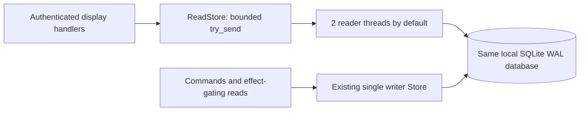

# Database read pool design

Requested 2026-11-26. User answers recorded below; the revised design still
requires review before implementation. Source inspected: main `d59a4541`.
This document changes no runtime, contract, requirement disposition or
qualification result.

## User decisions — 2026-11-26

1. `database_readers` defaults to 2, accepts 1–8, and is always on; no enable
   switch.
2. Any reader-open failure fails startup with a clear, nonsecret error; no
   fallback to the writer. Readers rely on the writer's full startup validation
   under the same guard, then perform only the fast checks specified below.
   There is no fixed per-reader full-scan deadline.
3. On the coordinator's WSL host, the ordinary loaded status-poll acceptance run
   must have zero `storage_unavailable`. Count `service_busy`; it is allowed
   only in the deliberately saturated test, not the ordinary loaded run.
4. Keep the public two-second request deadline and the one-second active
   read-transaction budget.

## Purpose and boundary

Separate display queries from the serialized command owner. Today
[`Store::start` and `Store::call`](../rust/crates/mover-store/src/lib.rs) send
both through a 32-slot channel to `mover-sqlite`. The service adds an eight-slot
`mover-status` observation queue in
[`Worker::start`](../rust/crates/file-mover/src/lib.rs). `operator_reply` waits
two seconds. A healthy database can therefore produce `503 storage_unavailable`
while reads wait behind commands. See
[the failure analysis](TEST-FLAKE-ANALYSIS.md); this mechanism does not establish
the cause of every reported test failure.

**A query-side result may only be displayed, never used to authorize anything.**
Every write, decision and read whose result gates an effect stays on the existing
writer: admission, replay validation, claim, delivery, cleanup, retry, cancellation,
resume, reset-missing, deletion and history clear. This includes predicates,
capacity checks, confirmation fingerprints and review/version checks inside those
operations. A displayed action button or review token is not authorization;
the existing command path revalidates it when used.

This is a bounded application of
[Fowler's command/query separation](https://martinfowler.com/bliki/CQRS.html):
separate interfaces sharing the same database, without another database,
replication, event sourcing or a durable read-model cache. Operator actions and
producer-lane fairness, including replays of finished recordings, are explicitly
deferred and unchanged. This design does not move or reschedule them.

## Configuration and resource limits

Add a top-level `database_readers` integer: **default 2, range 1–8 inclusive**.
Missing means 2; zero, negative, fractional, out-of-range or incorrectly typed
values fail normal configuration validation before effects. Changing it requires
a restart; TLS reload refuses the change with the other non-TLS settings.

Each reader owns one connection and one named OS thread (`mover-read-N`), with
one `std::sync::mpsc::sync_channel(1)` queue. Dispatch tries queues in rotating
order and tries the others on Full, without waiting for a free slot. Thus at most
**N running plus N queued requests** exist in the pool (4 at default, 16 at
maximum). Use a shared 2N permit budget acquired with a nonblocking operation
before dispatch and released on completion/drop, including cancellation. Full
queues or exhausted permits produce existing `503 service_busy` immediately.
Dead channels are availability failures, not successful overload admission.

A single additional std monitor thread maintains at most N active request slots
for deadlines/interruption. No thread, connection, task, timer or result is
created per incoming request. The current Tokio oneshot reply mechanism is
reused; pool scheduling and the monitor use std only. Keep existing query limits
(page limit 256, search chunk limits and validated inputs), and do not retain
completed results after their response owner drops. Queue bounds are not a claim
of a whole-process memory cap: returned job details, SQLite caches and responses
also consume memory. Set each reader's SQLite page-cache target to 4 MiB using
connection-local `cache_size`; this is a target, not a hard allocation limit.

No new crate, dependency feature, unsafe application code or connection-pool
framework is proposed. The pinned rusqlite dependency remains unchanged.

## Guarded startup and opening connections

Choose **fail startup**, with no fallback to the writer. A silent fallback would
reintroduce the failure being addressed and make qualification ambiguous.

1. Acquire the existing instance/lifetime guard and validate local state paths
   and sidecars. The writer's normal startup validation is authoritative:
   compatibility, schema structure, application ID, identities, job sequence,
   contents and SQLite options. Complete it once for the pool under this same
   continuously held guard. Do not repeat full validation per reader. Finish
   enrollment/destination authorization and configured limits.
2. Before claim/delivery threads or listeners can accept work, open all readers
   against that same database. Startup writes must have finished, and no writer
   transaction may run while the readers check startup identity.
3. Factor a fast, validated reader-open path alongside the existing
   `Store::open_read_only` → `Database::open(path,true)` path. Do **not** call the
   existing full-scan read-only open once per reader or weaken it for offline
   callers. The fast path requires the successful writer-validation context
   tied to this guard and database. Use READ_ONLY, FULL_MUTEX and NOFOLLOW;
   check application ID, current schema version, the same instance ID, database
   device/inode, SQLite build options and journal mode WAL. These checks must
   not scan jobs/files or invoke `validate_identities`, `validate_job_sequence`,
   `validate_contents`, foreign-key scans or full schema validation again.
4. Keep `trusted_schema=OFF`, foreign keys ON and the existing 250 ms busy
   timeout; inherit the existing read-only path's `synchronous=FULL` and verify
   it. Add connection-local `query_only=ON` as defense in depth. Never create,
   migrate or change journal mode from a reader. Recheck safe database/sidecar
   names and the captured database device/inode around opens while startup is
   quiescent, without unsafe raw-descriptor probes. Fail on unsafe/substituted
   names. Each reader completes one real, small read transaction (reading its
   instance metadata) before declaring ready; this is not a retained-job scan.
5. Normal service work starts only after all N readiness acknowledgements and
   monitor readiness. **Remove the proposed ten-second aggregate reader-startup
   deadline.** There is no new fixed startup/full-scan deadline: large healthy
   history may take time for the writer to validate. Stop/cancellation remains
   available during startup, and cannot publish partial or late readiness.

`mover-fs` already depends on `mover-store`; adding the reverse dependency would
be a cycle. Put SQLite-only read operations/connection ownership in mover-store,
and the guarded threaded `ReadStore` orchestration in file-mover. The service
supplies validated startup context and holds guard Arcs in every reader/monitor
thread. No new caller may bypass filesystem validation by opening a raw path.
Do not implement this as N public, write-capable `Store` clones with generic
closures. A narrow query enum and display DTO methods expose only the four
query families. Shared SQL/view helpers can be reused privately on a read
transaction; command code keeps using its writer transaction helpers.

A spawn/open/readiness failure requests stop through the existing Lifecycle,
closes all queues, cancels started work and joins every started thread before
releasing its guard. A late open cannot publish readiness after cancellation.
Cancellation does not permit detaching a thread stuck in kernel I/O. Report
which reader could not open using its numeric index and safe failure category;
never include SQL rows, credential values or arbitrary path/error payloads.

## Filesystem and WAL sidecars

`InstanceGuard::validate_database` in
[instance.rs](../rust/crates/mover-fs/src/instance.rs) checks the local private
state parent and database, `-wal`, `-shm` and `-journal`: mounted-leaf exclusions
before touching candidates, no symlinks, regular single-link files, effective
UID ownership, safe permissions, same device and a local-filesystem allowlist.
Readers must pass this same gate. State on NFS remains refused; production NFS
is not enabled by reader pooling.

READ_ONLY does **not** promise zero sidecar filesystem activity. SQLite permits
read-only WAL opens with existing readable sidecars or a directory where they
can be created. Do not use `immutable=1`, `nolock`, shared-cache mode or
read-uncommitted against the live database. Do not manually create, truncate,
remove or restore sidecars. [SQLite WAL documentation](https://www.sqlite.org/wal.html)
describes these requirements.

Keep the writer open first and last. New databases are already prepared 0600 by
the guard; verify newly created sidecars are service-owned and 0600 too. Existing
files must retain the existing guard's accepted permissions; that validator
permits some read bits beyond 0600, so this design does not silently tighten or
chmod them. SQLite's Unix VFS derives sidecar permissions from the database;
verify the **pinned build's actual behavior** in tests, including a missing shm.
See the primary [Unix VFS source](https://github.com/sqlite/sqlite/blob/master/src/os_unix.c).
Never change process-wide umask temporarily in a reader thread. Preserve
SQLite's locking discipline when factoring identity checks: do not add raw
open/close probes of an active database file alongside SQLite connections.
Startup filesystem checks precede active transactions; subsequent checks must
not release process-wide advisory locks through an unrelated descriptor close.
See SQLite's [locking warning](https://sqlite.org/howtocorrupt.html).

At steady state, no reader reconnects or opens another database. Use normal guard
identity checks, not the full metadata-based startup validation on every query:
WAL/database metadata legitimately changes while the writer commits. An identity
or guard failure must not trigger adoption, fallback or automatic repair.

## Dispatch and exact call-site scope

After current framing, audience, session and read authorization checks, async
handlers submit directly to ReadStore and await a oneshot. No synchronous Store
call, blocking queue send, SQLite operation or thread join runs on an async
handler. Display work bypasses `mover-status`; that thread remains only for its
existing command/control responsibilities, with their ordering unchanged.

| Current call site | Proposed destination |
|---|---|
| `lib.rs::connection`: GET `/api/v2/jobs/{id}` in prototype/private operator modes; `Observation::Status` → `status_response` → `Store::status` | ReadStore Status; preserve the same JobStatus envelope and `job_view` derivation. Native/protected producer audiences remain unable to read jobs. |
| `lib.rs::connection`: GET `/api/v2/retention` and `/api/v2/jobs/{id}/retention`; `Observation::Retention` → `retention_response` | ReadStore Retention. |
| `admin.rs::detail`: GET job detail through `Observation::Status` | ReadStore Status after existing session authorization. |
| `admin.rs::history`: GET `/api/v2/admin/jobs` through `Observation::Page` → `page_response` | ReadStore Page, including instance/cursor binding and all status rows in one transaction. |
| `admin.rs::search`: GET file-name search through `Observation::Search` → `search_response` | ReadStore Search, including cursor instance binding and the existing whole-job chunk rules. |
| `admin.rs::retention`: global or per-job admin retention | ReadStore Retention; retain the current admin wrapping/error conversion. |
| `admin.rs` SSE ready/changed events and periodic progress snapshots | No SQL currently: watch version plus in-memory `progress::BOARD.snapshot()`. Keep these unchanged. Browser-triggered history/detail/retention/search refreshes use the above pool routes. Any future pure SQL SSE snapshot must use the same bounded pool and release its transaction before streaming. |
| `admin.rs` settings GET | No Store access: returns the sanitized startup `admin.settings` snapshot. Keep it in memory; do not add a pool request. |
| GET `/healthz`, lifecycle `--status`/stop and TLS status/reload IPC | Keep their existing independent paths; health does not become a database probe. |

Sources: [service routing/views](../rust/crates/file-mover/src/lib.rs),
[admin handlers](../rust/crates/file-mover/src/admin.rs),
[search SQL](../rust/crates/mover-store/src/search.rs) and
[retention SQL](../rust/crates/mover-store/src/retention.rs).

The following **stay on the command side**, even when named like a read:
`Observation::RetryScope`, `DeletePreview`, Resume, ResetMissing, Retry, Cancel,
Clear and DeleteStart; admin `instance_scope`, retry context/action proof reads
and all corresponding decision transactions. Producer new submissions and
replays still go through the claim lane and writer. Claims, delivery candidate
selection, manifests, source/destination cleanup, missing-file/capacity retries,
worker reconciliation, history-clear eligibility, migration, backup and offline
inspection are unchanged. `missing_retry::visit` using `Store::status`
is an effect-gating read and **does not move**. This is a routing boundary, not
a global replacement of every Store read method.

## Transactions, deadlines and cancellation

Each accepted query has a **two-second end-to-end pool deadline**, starting at
submission, including queue wait and result delivery. Keep today's public timeout
and response shapes. Separation removes write-queue residence instead of masking
it with a larger timeout. A healthy, non-overloaded pool is expected to answer
within that bound; no scheduler or local disk provides an unconditional guarantee.

On dequeue, discard cancelled/expired work before opening a transaction. Then
run the same `InstanceGuard::validate()` check that the observer performs today,
**for every pool request before its transaction**. On failure return the current
409 `recording_blocked` guard refusal and execute no query; do not substitute a
cached startup check or a full database/sidecar scan. Guard-check time counts
against the request deadline, which is rechecked before BEGIN. Each
query uses one deferred read transaction with an active budget of **one second**,
or the remaining request budget minus 100 ms for reply handling, whichever is
smaller. If no time remains, fail without starting. Start the active timer before
BEGIN; end the transaction before formatting/writing a network response.

Read instance/cursor identity, status subqueries, page rows or retention aggregates
within that one transaction. Currently page/search obtain `Store::instance_id`
separately; the pool must combine them with the data read. No nested transaction,
per-row connection checkout or transaction spanning requests. Retention's
`configured_limits` currently lives in `Database::limits`, not SQL: give readers
the same immutable startup limits. Append the existing cached source-space
admission snapshot after SQL; it remains an independently sampled memory value,
not evidence for capacity authorization or a claim of SQL/filesystem atomicity.

Use the existing safe rusqlite `get_interrupt_handle`/`InterruptHandle` facility
from the fixed std monitor, checking active deadlines at most every 10 ms.
The implementation must verify availability in pinned 0.40.1 without feature
changes; do not assume a feature-gated progress callback or introduce unsafe FFI
(the workspace forbids unsafe application code). Worker Rust row/decoding loops
also check deadline/cancellation between bounded pieces of work.

Each worker has a monotonically increasing request token and active slot. Arm,
interrupt, retire and start-next transitions synchronize on that slot: the monitor
can interrupt only the matching active request; next work cannot start until
its predecessor's statements are finalized, transaction ended and slot retired.
On expiry, disconnect or shutdown, mark cancellation and interrupt matching
active work. Do not consider a timeout reply proof that its transaction closed.
Recheck cancellation before SQL steps and completion so interruption between SQL
statements cannot be lost. A timed-out result is discarded, never cached.

After interruption, explicitly finalize statements and end/roll back the read
transaction. Verify autocommit before reuse. If rollback/connection health cannot
be established, quarantine that connection and request lifecycle stop; never
send it the next request or reconnect behind the guard. A worker panic likewise
requests stop, fails pending requests and joins through ordinary teardown.

SQLite interrupts are cooperative, may arrive just after an operation finishes,
and do not forcibly terminate an OS read. Consequently one second is the active
**execution/cancellation budget**, not a hard kernel-I/O or WAL-size guarantee.
Do not detach a reader to pretend its snapshot ended. This limitation and guard
retention are required by
[SQLite's interrupt contract](https://www.sqlite.org/c3ref/interrupt.html).
A stuck reader consumes only its fixed slot; other workers can serve until
capacity is exhausted. Stop remains available through independent control IPC.

Long snapshots can delay checkpoint progress. End every request transaction,
keep default writer checkpoint policy unchanged and measure WAL growth and
checkpoint recovery after readers finish. Do not run checkpoints on read-only
connections. No finite transaction target can cap WAL bytes under arbitrary
writer throughput or stalled I/O; no WAL truncation or cleanup is authorized.

| Outcome | Existing public behavior retained |
|---|---|
| No queue/permit capacity | 503 `service_busy`, retryable, fast refusal. |
| Query deadline/SQLite error/failed reader | 503 `storage_unavailable`, retryable; never return partial status. |
| Missing job | 404 `not_found`. |
| Invalid cursor/input | Existing 400 response. |
| Service stopping or invalid guard | Preserve current `service_stopping` / guard-refusal mappings; no fallback or new access. |

Classify internal timing/error metrics separately (queue delay, active duration,
cancel/timeout, overload, safe SQLite numeric code). Do not log SQL parameters,
raw rows, credentials, session cookies or full diagnostic objects. Public JSON
adds no pool diagnostics or new error code. Deadline cleanup cannot cancel any
command or undo an effect: this cancellation applies only to read-only queries.

## Consistency, clear and shutdown

WAL readers see committed snapshots; a transaction's first database read fixes
its view, and a later transaction can see subsequent commits. Different replies
or page requests need not share a snapshot. Do not enable read-uncommitted or
hold a history/search snapshot across cursor requests.
[SQLite isolation documentation](https://www.sqlite.org/isolation.html) explains
this behavior. No asynchronous replicated model adds further propagation delay.

A display request already in progress may finish with the previous committed
state after an action commits. A new request after a completed writer commit
must use a fresh transaction and see it (or a still newer state). No connection
may remain in a transaction between requests. Tests that read while an action
or background delivery is still in progress should poll the existing completion
condition; tests reading after a confirmed commit must not be weakened to allow
indefinite stale data. History/detail read-own-write and SSE refresh tests need
this ordering made explicit. SSE is a change hint, not a commit receipt or a
cross-connection snapshot/version fence.

**Offline** `--clear-history`, inspection, migration and backup keep exclusive
instance/lifetime admission and create no pool. While even one daemon reader is
alive, its guard ownership prevents offline commands from opening state. All
reader connections must be gone before an offline history clear can begin.
The code also has **online dashboard clear**, `Observation::Clear`: it stays on
the writer with existing effect/eligibility checks, unchanged. An earlier display
snapshot may show a just-cleared job until that request ends; fresh transactions
see its absence. No display cache reconstructs or adopts cleared linkage, and no
query result can reauthorize an action on it. This distinction preserves both
existing clear paths rather than replacing online clear with an offline rule.

On stop, use existing Lifecycle serialization and its unchanged first deadline.
Refuse new queries, close dispatch queues even if handler handles survive, discard
queued requests, cancel/interrupt active readers, and join the N actual reader
threads plus monitor. Close readers before closing the writer, then release the
instance guard only after all other existing owners have exited too. The monitor
stays available through reader cancellation; interrupt handles cannot outlive an
unsafe raw connection pointer. A control status of ShutdownIncomplete may persist
while a reader is stuck; retain PID and guard, never detach/adopt/kill by name or
repair sockets/state. The logging writer's separate 250 ms rule is not a model
for custody-owning reader shutdown.

## Why the writer is not pooled

SQLite serializes writes even with several connections. More write connections
would compete for locks and encounter the existing 250 ms busy timeout, without
parallel write throughput. They would also split in-memory reservations and
command ordering. Keep one writer and its present transactions, admission and
callbacks. The pool only removes unrelated display work from that queue; it does
not solve disk stalls, all operator-action timeouts or producer-lane fairness.

## Planned tests and measurements

These are acceptance work for implementation, **not results**:

| Area | Required evidence |
|---|---|
| Configuration | Default 2; accepted 1/8; invalid 0/9/negative/fraction/string; validation before effects; restart-only and TLS-reload refusal. |
| Guarded opens | Writer validation rejects wrong schema structure, damaged sequence/identities or corrupt contents once; reader fast checks reject application/schema-version/instance/device/inode/build-option/journal mismatches. Every worker is read-only with query_only, trusted_schema off and inherited synchronous=FULL. Reject unsafe parent/sidecar, symlink, hardlink, mounted leaf and NFS through the guarded path. Preserve rejected files; never create a database. |
| Retention-scale startup | At the stated 10,000-job / 2,560,000-file qualification bound below, test N=1/2/8: full validation once, fast checks and one small real transaction per reader, successful startup without a new fixed deadline. Corrupt the final job and prove writer validation still fails startup. |
| Per-request guard | Invalidate the named guard after pool startup, then submit each query family. Assert 409 recording_blocked and no transaction begun, including a request queued before invalidation. |
| Sidecars | Actual pinned SQLite fresh/existing WAL, missing shm and restart tests under permissive process umask; no newly over-permissive files. Check identity/owner/modes before and after, preserving unsafe originals on refusal. |
| Startup failure | Fail one of N opens/spawns and cancel while waiting for readiness; report a clear safe error, with no fallback, Ready or detached thread. No guard release before all started threads exit. |
| Pool exhaustion | Barrier-hold all running and queued requests; next request promptly gives service_busy (target under 100 ms on the controlled local fixture). Cancelled queued jobs never begin SQL. Bound accepted work at 2N. |
| Snapshot | Pause after first read, commit related changes on writer, finish multi-query status/page/retention on old internally consistent snapshot; next request sees the committed change. Cursor binding shares the same transaction. |
| Active bound | Expensive SQL and Rust decoding exceed the one-second budget, return storage_unavailable within the two-second request budget on the controlled host, roll back and release the snapshot. Race cancellation at statement boundaries and next-job start: do not interrupt the next job. |
| Independent writes | Barrier-hold a writer operation while status/history/retention/search still complete from reader snapshots. Conversely, a bounded reader snapshot permits command commits. |
| WAL checkpoint starvation | Dedicated two-reader continuous-poller test described below; observe partial checkpoint progress/WAL growth under deliberately overlapping snapshots and recovery after pollers stop. Do not infer recovery just from file size. |
| No action moved | Query enum has only Status/Page/Retention/Search, no arbitrary SQL/closure or Store command capability. Writer/effect helpers cannot take ReadStore/DTOs as authorization. Keep action/replay tests and add a stale-display/fresh-command-state test proving the existing writer revalidation wins. |
| Routing and sessions | Private operator and admin reads bypass mover-status; query floods do not acquire command slots. Producer routes remain forbidden; session/CSRF/boundary and sign-out rules remain intact. Settings, SSE memory snapshots and health perform no SQL. |
| Shutdown | Paused active/queued readers, client disconnect, panic and partial startup; actual exits and connection closure precede guard release. Offline clear refuses until readers exit; online clear leaves no stale cross-request transaction or cache. Test reader hold beyond first deadline reports incomplete shutdown safely. |

`max_retained_jobs` has no supported finite upper bound today, so do not claim
a test covers a nonexistent maximum. State a **qualification bound of 10,000
retained jobs with 256 files each (2,560,000 file rows)**, plus a smaller
1,000-job comparison. This is a disposable synthetic database, not payload
files or a new product limit. Retain valid UUIDs, file membership, reservation
and identity relationships. Use test-only instrumentation to count the writer's
full-validation pass and each reader's fast checks; do not use an arbitrary
startup duration to infer the scan count. Measure writer validation and reader
opening separately for N=1/2/8 and report source, dataset size and timings.
Larger retained states remain allowed; this test adds no startup time ceiling.

For checkpoint starvation, use a disposable WAL database and N=2. Two continuous
pollers use test barriers to overlap bounded snapshots: at least one old snapshot
remains active while the writer commits a finite stream of updates. Each request
still obeys the one-second active budget; barriers are test-only and released on
failure. Observe checkpoint frame counts through the existing writer connection
using nonblocking PASSIVE checkpoints, and WAL high-water bytes. Establish the
old reader's snapshot before the writes so that partial progress is meaningful;
continuous polling alone is not proof of a held old snapshot. Then stop both
pollers, drain/close all read transactions and run the writer's checkpoint again.
Require checkpoint completion (all relevant frames checkpointed, no busy reader)
and a fresh reader seeing the latest commit, within a generous controlled-host
recovery wait. WAL file size need not shrink after PASSIVE; never delete/truncate
it to make the test pass. Keep writes succeeding while snapshots overlap, and
verify interruption/rollback frees the snapshot when its active budget expires.
This isolates checkpoint starvation from ordinary status-poll acceptance and
changes no production checkpoint policy.

Extend the existing sustained sender-load test with a bounded independent status
poller. Record separate status successes, service_busy, storage_unavailable,
request count and p50/p95/p99/max monotonic latency; keep health checks and every
late-claim, replay, no-blocking, commit and zero-delivery-failure audit. Use
known accepted job IDs and retain diagnostics on unexpected replies. Poll serially
at 50 ms intervals by default so this measures loaded display responsiveness
rather than deliberately exhausting the read pool. Exercise admin history,
retention and search in a separate finite mixed-query test as well.

On the coordinator's controlled WSL/gate-SQLite host, require **zero
storage_unavailable** in the ordinary loaded query run and every successful query
inside the existing two-second deadline. Count service_busy in both runs;
it fails the ordinary loaded status-poll acceptance run. It is expected and
allowed only under deliberate pool saturation. Neither requirement is a claim that
physical I/O failures can never return storage_unavailable. A test exceeding its
read budget fails qualification for that workload; do not call a timeout a pass
or silently truncate a search job to hit a latency target.

Compare before/after on the same host, filesystem, debug/release mode, fixtures,
logging setting and sender pacing, in alternating repeated pairs (initially ten).
Record throughput, back-pressure, late claim time, delivery time, status latency,
CPU/RSS, WAL high-water size and post-load checkpoint recovery. Separate protocol
latency from test-scheduler delay using bounded queue/active timing. Require no
lost/duplicate jobs, no changed action outcomes, zero unexpected read failures
and no sustained delivery regression outside measured run variability. Publish
all samples and uncertainty; any proposed numeric transfer-regression threshold
beyond existing approved requirements comes back for approval. Do not infer
improvement from one fast run or claim to reproduce all #121 failures.

## Rollout and approval

After review and user approval, use small PRs:

1. Extract shared read-transaction helpers and add the narrow validated
   read-only connection API, with validation/snapshot tests; routing unchanged.
   Confirm the pinned interrupt API without dependency/feature changes before
   integrating deadline control; raise a design blocker if it is unavailable.
2. Add pool/config/lifecycle ownership, cancellation and exhaustion tests, then
   switch the four display families directly to it in one integration PR. Keep
   command observer operations unchanged. Run all existing API/admin/reload and
   focused concurrency tests locally before review.
3. Add status-load measurements and operator instructions; update
   [ARCHITECTURE.md](ARCHITECTURE.md) and its SVG **in implementation**, with
   actual results and limits. Both required SLES gate modes and independent
   review remain required; ship no qualification claim without final reports.

No permanent enable/disable switch: it would retain a second display routing
path and an easy way to hide reader-start failures. Omitted configuration selects
the tested two-reader default; one reader is supported for resource-constrained
hosts, still isolated from the writer. Existing state and schema are unchanged.
Rollback means the previous compatible executable after a clean stop, subject to
existing compatibility checks; never restore stale state. Pool sizing, deadlines,
and fail-start policy are recorded user decisions above. The revised startup
checks and remaining implementation details still require design review.

This PR contains documentation only. No builds, new dependency, installation,
real state, NFS experiment, operational conversion or implementation is performed.
All FR release gates remain open.
