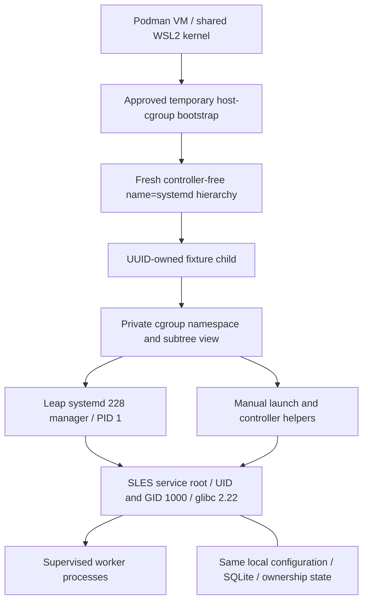

# Systemd lifecycle lab: infrastructure and test procedure

This is the repeatable controlled-container procedure, not a production install
guide. Read [testing limitations](TESTING-LIMITATIONS.md) before interpreting a
pass. Results, exact run IDs and failures belong in
[increment 59](RUST-INCREMENT-59.md); the earlier private-only 228 preflight in
[58](RUST-INCREMENT-58.md) remains blocked historical evidence.

## 1. Understand the environment

The reference environment is Windows invoking a rootful Podman connection into
its WSL2 Linux VM. Rust builds execute in the pinned Linux builder, not directly
on Windows or under `/mnt/c`. Exact tests execute in pinned SLES 12 SP5 userspace.
The systemd lab uses a separate container with local disposable payload/state.
It mounts no NFS share, publishes no port and has no external network access.

The 228 manager comes from the official, digest-pinned Leap 42.3 image. Its RPM
is a **228 equivalent**, not a SLES-maintained RPM revision. The mover, its workers
and local controllers execute under `RootDirectory=/sles` or equivalent chroot
in the unchanged pinned SLES 12 SP5 root, with glibc 2.22. A real SLES installation
is not required. The `container=docker` environment value is only a compatibility
hint recognized by v228; the actual engine is Podman.



This bootstrap temporarily reaches shared VM cgroup state. The user explicitly
approved that broader boundary on 2026-10-18. Do not infer authorization for other
machines, existing hierarchies or unrelated processes. The ordinary 252 fixture
and private-only 228 preflight do not need this broader path.

## 2. Check prerequisites and the checkout

Use Python 3.11 or newer, Git, a working rootful Podman VM/connection, enough free
space for the pinned images and Rust caches, and the feature-branch checkout.
From the repository root in PowerShell:

```powershell
git branch --show-current
git status --short
python --version
podman machine list
podman system connection list
$env:CONTAINER_CONNECTION = 'podman-machine-default-root'
podman info --format '{{.Host.CgroupVersion}}'
podman ps -a
```

The branch is `feature/rust-transfer-coordinator`. Preserve unrelated local work.
If the existing `podman-machine-default` is stopped, start it with
`podman machine start podman-machine-default`, then repeat `podman info` and
the inventory. Use the already configured rootful connection; do not change
VM boot/controller configuration or replace the VM during a run.
The reference VM uses cgroup v2. Do not switch its boot/controller configuration
to make this test pass. Do not stop unrelated containers. Only one approved 228
fixture can own the legacy `name=systemd` hierarchy at a time.

## 3. Build and test the exact Rust inputs

Run both mandatory gates, checking each exit status. The gates print their new
output directories; retain those paths. They may run concurrently as separate
processes, but let their owned containers clean up before running the legacy lab.

```powershell
python scripts/check-rust-sles.py
if ($LASTEXITCODE -ne 0) { throw 'Production SLES gate failed' }
python scripts/check-rust-sles.py --qualification
if ($LASTEXITCODE -ne 0) { throw 'Qualification SLES gate failed' }
```

Each gate formats/lints, checks the locked package/feature graph, builds GNU/glibc
2.22 debug/release artifacts with cargo-zigbuild, audits every ELF and executes
the exact tests in pinned SLES userspace. Loader/library/symbol negative controls
must also pass. A host-only Cargo test is insufficient.

Set variables to the directories printed by your runs, not someone else's IDs:

```powershell
$ProductionGate = 'rust/validation/<production-run-id>'
$QualificationGate = 'rust/validation/<qualification-run-id>-nfs-qualification'
```

The lifecycle driver refuses a failed gate or changed Rust inventory and checks
all four copied service hashes. Reusing an older gate is allowed only for exact
unchanged Rust bytes, followed by fresh-gate artifact comparison in the increment
audit. Do not rebuild a service outside the mandatory gate.

## 4. Build the two fixture image layers

Use the same Podman connection as the runner. Initial image acquisition needs
network access; runtime containers do not. The base recipe uses pinned SLES and
Leap digests and does not register a SUSE subscription or install production deps.

```powershell
podman build -t localhost/background-file-mover-systemd228 -f scripts/systemd/Containerfile.228 scripts/systemd
if ($LASTEXITCODE -ne 0) { throw '228 base build failed' }
podman build -t localhost/background-file-mover-systemd228-approved -f scripts/systemd/Containerfile.228-approved scripts/systemd
if ($LASTEXITCODE -ne 0) { throw 'Approved bootstrap image build failed' }
podman image inspect localhost/background-file-mover-systemd228-approved --format '{{.Id}}'
```

The approved layer adds the bootstrap/entry/empty-cgroup cleanup helpers and
explicitly provisions the mover primary group as GID 1000. Leap's default
`useradd` chooses `users` (GID 100); a missing `mover` group caused the retained
GROUP/216 setup failure. The driver checks UID/GID before testing the unit.
It deliberately has a different tag from the private-only preflight image. Do
not directly start that image: the driver supplies its owner nonce and cleanup.
Keep image IDs, package inventories and driver hashes with the evidence.

## 5. Run the approved matrix

```powershell
python scripts/check-systemd-boundaries.py $ProductionGate --qualification-gate $QualificationGate --manager 228 --allow-host-cgroup-bootstrap
if ($LASTEXITCODE -ne 0) { throw '228 lifecycle qualification did not pass; inspect its report' }
```

`--manager 228` without the explicit bootstrap switch refuses before starting a
container. The switch acknowledges the broader operation; it is not a substitute
for actual operator authorization. The default manager profile remains 252.

The driver creates one disposable privileged container with private mount/PID/
network namespaces, no host volumes, no network and initial host cgroup-namespace
access. It passes a new hexadecimal owner nonce to the bootstrap.

## 6. Verify the bootstrap before accepting test results

The scripts and driver perform these checks, in order:

1. Read host-namespace cgroup membership and refuse any existing `name=systemd`
   hierarchy before creating a fixture. The bootstrap rechecks after making
   mounts private. Never attach to an unknown hierarchy or change an existing
   controller assignment.
2. Mount a new controller-free named hierarchy in the container's private mount
   namespace; create `file-mover-owned-<nonce>` and move only the bootstrap PID.
   Emit the nonce-bound creation attestation to the captured boot log; cleanup
   requires it before attaching to this run's hierarchy.
3. Unshare the cgroup namespace. Mount tmpfs at the container's cgroup root and
   the namespace-rooted v1 view at its `systemd` child. Unmount the inherited
   global-root view before starting systemd.
4. Require different outer/inner namespace IDs, matching manager/helper inner
   IDs, v1 filesystem magic `27e0eb` and absence of the outer owned-child path in
   the private root view. Helpers refuse incomplete/wrong mounts and namespaces.
5. For each later exec, move only that helper's own PID into the fixture root,
   join the manager's cgroup namespace, then drop identity/chroot as appropriate.
6. Require a responding manager bus, actual manager/version/package/glibc records,
   the pinned SLES OS/libc, correct artifact hashes and shared PID namespace.

PID 1 existing is insufficient. The blocked private-only v2 preflight demonstrated
that a process named systemd can remain alive without a functioning manager bus.

## 7. Follow the baseline sequence

Repeat this sequence for production/qualification artifacts in debug/release:

1. Initialize private local roots, configuration, SQLite and source enrollment.
   The nested input is 2 MiB plus 17 bytes; retain expected SHA-256 and identities.
2. Install the candidate v228 unit and require its actual verifier to accept it
   without unknown directives. Use Service.StartLimitInterval/StartLimitBurst.
3. Start the unit and confirm application `/healthz` separately from Type=simple
   active state. Check UID/GID 1000, zero capabilities, NoNewPrivs and mapped libc
   2.22; record foreign-UID CLI and unprivileged unit-control refusal.
4. Submit the job, require 202/path release, reuse the original producer path and
   verify committed destination/manifest hashes with retained private source.
5. Require competing manual effect commands and a second unit to refuse. A
   same-port start may fail at bind; an alternate-port config changes only bind
   and must still refuse on the same state/storage guard.
6. Stop via the mover's same-user local controller. Start manually, attempt unit
   starts and require bounded restart refusal while the original epoch stays held.
7. Arm both launchers before releasing each of two start races. Different ports
   avoid masking guard behavior. Require exactly one live owner and guard refusal
   by the loser, then confirmed exit before the next round. This does not test
   fairness or every scheduling interleaving.
8. Confirm the loaded default budget is 60, perform clean stop, require
   NoActiveOwner and a successful same-state manual restart/stop.

The minimal 228 image has a responding root/private manager bus but no full
system D-Bus/polkit installation. An unprivileged `systemctl` refusal there may
be a missing/inaccessible bus, not a tested administrator authorization rule.
Record its actual diagnostic. `User=mover` changes the service identity; it
does not grant that account permission to manage system services. Actual
administrator-provisioned start/stop policy remains unqualified.

## 8. Follow the qualification-only fault cases

Repeat each in debug/release; no production qualification controls are enabled:

| Case | Controlled trigger | Required result |
|---|---|---|
| Incomplete stop | Pause local drain, loaded application wait 2, fixture manager timeout 8 | Application ShutdownIncomplete/exit 2 and same live epoch; competing starts refuse. Record actual manager reply separately. Release pause, confirm exit, then deliver normally. |
| Manual orphan | Pause copy after 1 MiB, SIGSTOP its worker, kill manual coordinator | OwnerUnavailable and retained exclusion; bounded managed start refusals. Release/CONT worker, confirm actual exit, recover attempt 2 from original state. |
| Managed crash | Pause/SIGSTOP managed copy worker and kill only the unit's main PID | Observe old main/worker exited when first observing replacement; confirm application readiness and original-state attempt-2 recovery. Polling cannot prove absence of arbitrarily short overlap. |

Fault recovery must preserve original database/source inodes, enrollment receipt,
retained old partial allocation/content and producer-reused paths. Every record
must validate manifest/hash, stable roots, retained source and cleanup false.
These local pauses are not hard-NFS blocking or proof of NAS RPC cancellation.

The legacy unit deliberately omits the global `ExecStop=... --stop` controller.
The retained failure shows that 228 can run it after a contender fails the
ownership guard, stopping the legitimate owner in another unit or a manual
start. Use normal manager SIGTERM/control-group behavior to target only the
unit's own processes. The default 252 fixture is historical comparison evidence;
neither candidate is a production installation recipe.

During the legacy incomplete-stop case, start the manager stop job, then invoke
the same-user `--stop` controller independently. Require exit 2 within five
seconds, retain stdout/stderr/timing, and match its exact owner-epoch snapshot
against the later independent live status. The manager's separate reply/deadline
still has its own checks. A generic manager timeout cannot substitute for the
application result. The modern path retains its exact structured journal check.

Each legacy fixture unit also sets a unique `SyslogIdentifier` equal to its unit
name. The legacy journal query combines `_SYSTEMD_UNIT`, manager `UNIT` and
that explicit identifier. This keeps short-lived refusal diagnostics attributable
without reducing the required one-to-two guard-refusal count or losing the
manager's start-limit messages. The identifier is a fixture logging aid, not an
authentication mechanism or a change to the mover's ownership protocol.

## 9. Inspect evidence and failures

Each run prints `rust/validation/systemd-<timestamp>-<nonce>`. Keep `report.json`,
generated units/configs, per-process logs and journals. Check:

- Overall status, exactly ten case records and each actual `passed` value.
- Exact manager profile, scope, image/packages/kernel, cgroup namespace/mount
  evidence and four artifact hashes. Keep the SLES-maintenance-RPM limitation.
- Identity, original-state/hash/manifest evidence and final local ownership.
- Manager stop replies separately from application shutdown results. MainPID 0,
  a successful stop job, free raw lock or expired timer cannot prove old-worker
  exit or settled remote I/O.
- Cleanup errors and post-cleanup cgroup observation. An overall failure or a
  NOT_RUN record is never a qualified scenario, even if some cases passed.

Preserve failed reports separately when fixing a fixture or service defect.
Never rewrite historical failure/preflight JSON to say PASSED. A compiled
directive inventory only proves section/key availability; it is not a parser or
lifecycle pass. Publish actual run IDs/results in the increment report/catalog.

## 10. Verify cleanup

The runner releases local pauses and stops only fixture processes/units. It
captures journals and the bootstrap creation attestation, removes its owned
container, then uses the matching attested nonce to
remove only empty owned cgroup descendants with bounded `rmdir` attempts. It
does not signal/migrate unrelated processes or delete a populated cgroup. Empty
directories and kernel hierarchy lifetime need separate checks: removing the
container alone may leave cgroup references behind.
Without that creation attestation or the matching owned directory, do not
attempt empty-root teardown. A pre-existing hierarchy refusal is not permission
to clean up someone else's hierarchy.

The runner also retries empty-root mount/unmount within a bounded window and
requires the legacy hierarchy to disappear from a subsequent host-namespace
probe. In this VM, removing the child directories and waiting for all Rust-gate
containers to exit still left the empty hierarchy visible; another verified
empty-root mount/unmount released it. The upstream kernel's
[cgroup teardown path](https://github.com/torvalds/linux/blob/v6.18/kernel/cgroup/cgroup.c)
checks its child list at final unmount. Asynchronous child removal is the likely
explanation, not a proven trace of the reference lifetime in this VM.

```powershell
podman ps -a
podman volume ls
podman network ls
```

Compare against your initial inventory; do not remove other workloads. Retained
Rust cache volumes and fixture images are intentional. The report's cleanup must
also account for the temporary hierarchy. If ownership or cleanup is uncertain,
stop the lab and investigate the recorded nonce/paths; do not delete arbitrary
state, attach to an unknown hierarchy or reset VM controllers to hide the issue.

## 11. Understand what passing means

Use [the limitations matrix](TESTING-LIMITATIONS.md). This lab targets local
single-host lifecycle interactions with a selected manager equivalent. It does
not enable production NFS/deletion, qualify exact SLES RPM patches or the old
SLES kernel, or replace combined hard-NFS/systemd, packaging, account policy,
durability and release-candidate qualification.
